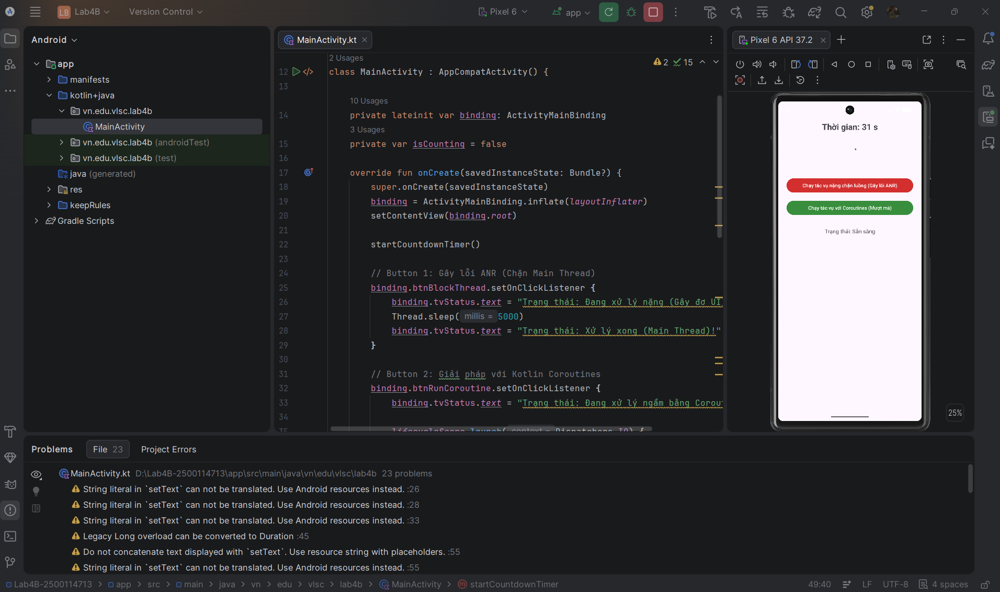

# Lab 4B: Xử lý Đa Luồng & Tránh Lỗi ANR với Kotlin Coroutines trong Android

## 📌 Giới thiệu Bài Lab
Bài lab **Lab 4B** (`vn.edu.vlsc.lab4b`) nhằm mục đích nghiên cứu và thực hành về cơ chế xử lý đa luồng (Multithreading) trong ứng dụng Android. Qua đó, giúp hiểu rõ nguyên nhân gây ra lỗi **ANR (Application Not Responding)** và cách giải quyết triệt để bằng **Kotlin Coroutines**.

Đỗ Minh Khoa - 2500114713


## 📸 Giao diện ứng dụng (Screenshot)




## 🎯 Mục tiêu bài học
1. **Hiểu về Main Thread (UI Thread)**: Biết vai trò của Main Thread trong việc xử lý giao diện người dùng và lý do tại sao không nên thực hiện tác vụ nặng (tốn nhiều thời gian) trên luồng này.
2. **Nhận biết lỗi ANR**: Thử nghiệm hành vi khi Main Thread bị block (chặn luồng), khiến giao diện bị đơ (freeze) và không thể tương tác.
3. **Ứng dụng Kotlin Coroutines**: Sử dụng Coroutines kết hợp với `lifecycleScope` và Dispatchers (`Dispatchers.IO`, `Dispatchers.Main`) để đưa tác vụ tính toán nặng xuống luồng phụ (Background Thread) mà không làm ảnh hưởng đến trải nghiệm giao diện người dùng.

---

## 🛠️ Các chức năng chính

### 1. Đồng hồ đếm ngược (Countdown Timer)
- Chạy tự động khi ứng dụng khởi chạy.
- Đếm ngược từ **60 giây về 1 giây** bằng Coroutine gắn liền với vòng đời của Activity (`lifecycleScope.launch(Dispatchers.Main)`).
- Dùng làm mốc kiểm tra độ mượt mà của giao diện UI khi thực thi các tác vụ khác.

### 2. Tác vụ gây lỗi ANR (Button 1 - Màu đỏ)
- **Tên nút**: `Chạy tác vụ nặng chặn luồng (Gây lỗi ANR)`
- **Cơ chế**: Sử dụng `Thread.sleep(5000)` trực tiếp trên Main Thread.
- **Hiện tượng**: Giao diện ứng dụng ngay lập tức bị đóng băng (đơ UI), đồng hồ đếm ngược ngừng chạy trong 5 giây. Nếu người dùng thao tác liên tục có thể xuất hiện cảnh báo ANR từ hệ điều hành Android.

### 3. Tác vụ xử lý bằng Coroutines (Button 2 - Màu xanh)
- **Tên nút**: `Chạy tác vụ với Coroutines (Mượt mà)`
- **Cơ chế**:
  - Khởi tạo Coroutine với `lifecycleScope.launch(Dispatchers.IO)` để chuyển tác vụ xử lý nặng xuống luồng ngầm (`IO Dispatcher`).
  - Sử dụng `delay(5000)` mô phỏng tính toán/tải dữ liệu ngầm mà không chặn luồng chính.
  - Sử dụng `withContext(Dispatchers.Main)` để cập nhật lại kết quả lên UI (`tvStatus`) sau khi hoàn thành.
- **Hiện tượng**: Đồng hồ đếm ngược vẫn chạy bình thường, giao diện mượt mà và ứng dụng phản hồi tương tác lập tức.

---

## 📁 Cấu trúc thư mục chính

```
Lab4B-2500114713/
├── app/
│   ├── src/
│   │   └── main/
│   │       ├── java/vn/edu/vlsc/lab4b/
│   │       │   └── MainActivity.kt          # Logic chính quản lý đếm ngược, ANR & Coroutines
│   │       └── res/
│   │           └── layout/
│   │               └── activity_main.xml   # Giao diện chính (TextView, ProgressBar, Button)
│   └── build.gradle.kts                     # Cấu hình dependencies (Coroutines, Lifecycle, ViewBinding)
├── lab4b.png                                # Ảnh chụp màn hình ứng dụng
└── README.md                                # File hướng dẫn bài lab
```

---

## ⚙️ Công nghệ & Thư viện sử dụng
- **Language**: Kotlin
- **UI Tool**: XML Layout + ConstraintLayout
- **Architecture/Binding**: ViewBinding
- **Multithreading**: Kotlin Coroutines (`kotlinx.coroutines`)
- **Lifecycle Management**: AndroidX Lifecycle Runtime KTX (`lifecycleScope`)
- **Min SDK**: 24 | **Target SDK**: 37

---

## 🚀 Hướng dẫn chạy ứng dụng
1. Mở dự án trong **Android Studio**.
2. Đồng bộ dự án với Gradle (Sync Project with Gradle Files).
3. Chọn thiết bị ảo (Emulator) hoặc thiết bị thật (Android Device).
4. Nhấn nút **Run 'app'** (`Shift + F10`) để trải nghiệm và so sánh sự khác biệt giữa nút bấm gây ANR và nút bấm chạy Coroutines.
